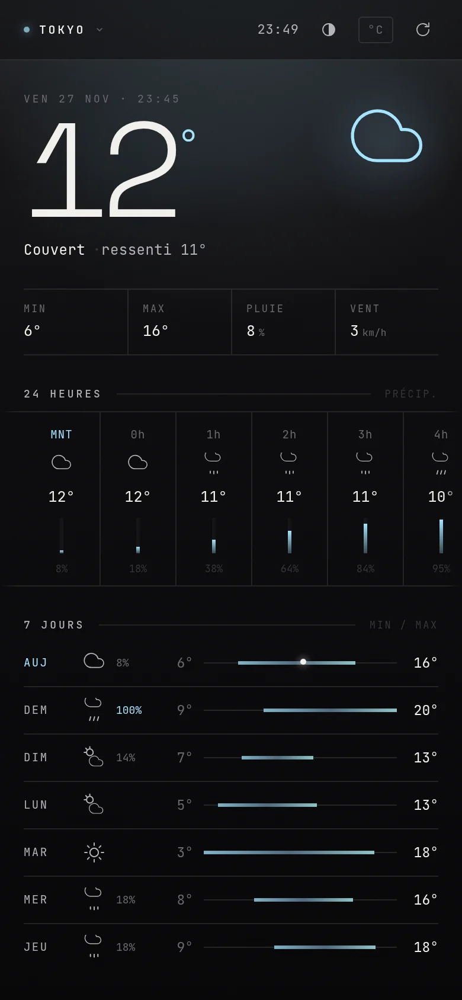
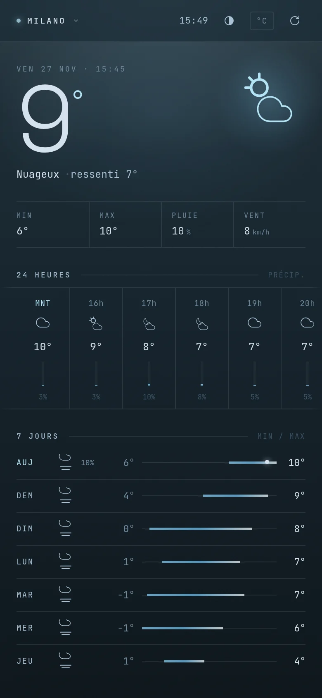
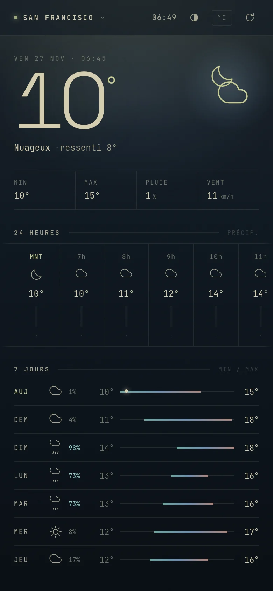

# ometeo

Météo minimale, mobile vertical — six thèmes repris d'Omarchy.

- zéro dépendance, trois fichiers (`index.html`, `styles.css`, `app.js`)
- données [Open-Meteo](https://open-meteo.com) (aucune clé, CORS ouvert)
- géolocalisation au premier lancement, sinon recherche de ville
- les 20 derniers lieux choisis restent en mémoire locale (feuille de recherche)
- taille du texte réglable en trois crans (normale, grande, très grande)
- dernière météo en cache local + service worker → l'app s'ouvre hors ligne
- PWA installable : manifeste, icônes maskables, métadonnées Open Graph
- écran d'ouverture dans la palette du thème (fond posé avant le CSS, pas de flash blanc)
- bandeau d'installation en bas d'écran (prompt natif sur Android, « Partager →
  sur l'écran d'accueil » sur iOS), refermable, masqué en mode standalone et
  sur desktop

## Captures

| Tokyo — Tokyo Rain | Milano — Lumon | San Francisco — Dusk |
|:--:|:--:|:--:|
|  |  |  |

## Thèmes

Le bouton ◐ de la barre ouvre la feuille **Affichage** (palettes + taille du
texte). Les deux choix sont gardés dans `localStorage` (`ometeo.theme`,
`ometeo.fs`) et appliqués avant le premier rendu, sans flash.

| id | nom | couleur |
|---|---|---|
| `aether` | Aether | violet, thème actif d'Omarchy (défaut) |
| `lumon` | Lumon | bleu glacé |
| `black-sand` | Black Sand | acier neutre |
| `tokyorain` | Tokyo Rain | noir profond, cyan |
| `forest` | Forest Night | vert menthe |
| `dusk` | Dusk | sable et bleu |

Chaque thème ne définit que onze couleurs ; le reste (filets, halos, fonds,
transparences) est dérivé en `color-mix()`. Pour en ajouter un :

1. copier un bloc `[data-theme="…"]` dans `styles.css` avec les couleurs du
   `colors.toml` du thème Omarchy voulu ;
2. ajouter une entrée dans `THEMES` (`app.js`) pour le sélecteur.

## Typo

JetBrains Mono (repli Agave Nerd Font Mono, la mono du terminal) et
Space Grotesk pour le grand chiffre. Le visuel de partage `og.png` est rendu
depuis `tools/og.html`.

## Hébergement local

Le dossier est servi tel quel, sans build, par un service systemd utilisateur
(`~/.config/systemd/user/ometeo.service`, port **8801**, démarré au boot) :

| depuis | adresse |
|---|---|
| cette machine | http://localhost:8801 |
| le réseau local | `http://<ip-de-la-machine>:8801` |

```sh
systemctl --user status ometeo     # état
systemctl --user restart ometeo    # après une modif (les fichiers sont servis en direct)
```

La géolocalisation exige HTTPS hors `localhost`. Deux façons d'en avoir sans
rien déployer ailleurs :

```sh
# 1. tunnel Tailscale, visible du tailnet seulement
tailscale serve --bg --https=8443 http://127.0.0.1:8801   # -> https://<machine>.<tailnet>.ts.net:8443
tailscale serve --https=8443 off                          # pour couper

# 2. GitHub Pages, si le dépôt est public
```

Sur `http://` hors localhost, le navigateur bloque la géolocalisation : l'app
retombe sur Bruxelles, ou sur la ville cherchée.

Pour un simple essai sans service :

```sh
python3 -m http.server 8080
```

`file://` fonctionne aussi, sauf le service worker et la géolocalisation.

## Publier

Le dossier tel quel suffit (statique, aucune étape de build).

En ligne sur GitHub Pages : **https://iesta.github.io/ometeo/**

`og:url`, `og:image` et le `canonical` pointent sur cette adresse : à changer
dans `index.html` si l'app déménage, sinon l'aperçu de partage pointera vers
l'ancienne.
